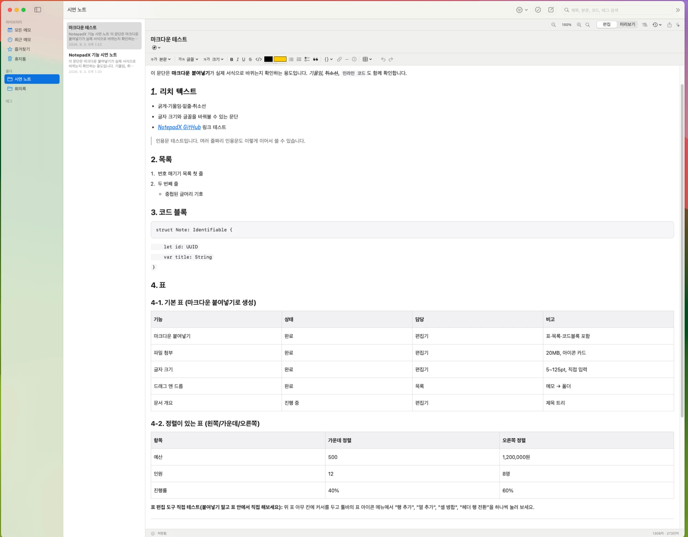
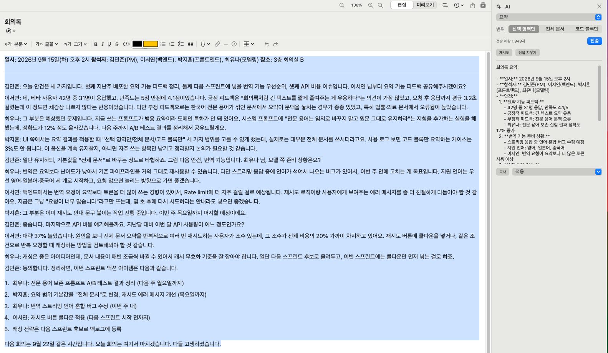

# Notepad

macOS용 노트 앱. 리치 텍스트/코드 편집, 폴더·태그 정리, 분할 편집, OneDrive 동기화, 다양한 형식 내보내기, OpenAI 기반 AI 글쓰기 보조를 지원합니다.

편안하게 .md의 문법을 사용하면서 작성이 용이합니다.



### 다운로드

오른쪽 사이드바의 `Release` 를 통한 Download

## 주요 기능

1. **독립적인 첨부파일 관리**

   - 첨부파일을 업로드하여 원본과 무관한 독립적인 파일로 즉각적인 편집 및 확인이 가능합니다.
   - 사용방법 : 폴더로부터 바로 노트 내용으로 드래그(직관적 사용)
2. **AI 글 작성 보조 및 요약**

   - 환경변수를 통하여 `OPENAI_API_KEY`에 ChatGPT API Key를 등록하면 AI 요약을 통한 글 작성 관리가 가능합니다.

   
3. **코드 블록 및 상호작용**

   - 코드 블록 기능을 통하여 빠르게 코드를 피드백하면서 상호작용을 할 수 있습니다.
4. **폴더 및 즐겨찾기**

   - 폴더별 및 즐겨찾기 기능으로 빠르게 북마크할 수 있습니다.
5. **이미지 빠른 삽입**

   - 맥의 기본 캡처 기능을 활용해 Notepad 본문 내 드래그로 손쉽게 이미지를 삽입할 수 있습니다.
6. **편집모드 / 미리보기 모드**

   - 작성 환경에 맞춘 편집모드 및 미리보기 모드를 제공합니다.
7. **태그 기반 문서 검색**

   - 태그를 통한 간편한 문서 검색 기능을 제공합니다.
8. **자동 본문 목차 정리 (TOC)**

   - 마크다운 문법을 사용하면 [미리보기] 버튼 옆의 목차 기능을 통해 본문 목차가 자동으로 정리됩니다.
9. **버전별 자동 저장**

   - 본문의 이전 작성 내용을 잊어버려도 버전별 자동 저장 기능을 통해 복구 및 확인이 용이합니다.
10. **다양한 포맷 내보내기**

    - 작성한 내용을 `내보내기` 기능을 통해 Markdown, HTML, PDF, DOCX 등 다양한 형식으로 공유할 수 있습니다.

## 추가 기능

#### 데이터 보호와 백업
- **자동 백업**: 앱을 켜 두면 하루에 한 번 데이터베이스(와 첨부파일)를 `Application Support/NotepadX/Backups/`에 복사합니다. 보관 개수와 외부 폴더(iCloud Drive·외장 디스크 등)를 설정 > 백업에서 정합니다. DB 스키마를 올리기 직전, 복원 직전에도 자동으로 백업을 남깁니다.
- **복원/점검**: 설정 > 백업에서 "복원…"(다음 실행 때 적용), "데이터 점검"(SQLite 무결성 검사), "저장 공간 정리"(VACUUM)를 쓸 수 있습니다. 무결성 문제가 발견되면 앱이 알려 주고 그동안은 백업을 덮어쓰지 않습니다.
- **버전 기록 용량 절감**: 메모 버전에 들어 있는 같은 그림(base64)을 한 번만 저장합니다. 내용은 손실 없이 그대로 복원됩니다.
- **메모 잠금**: 메모 우클릭 > "잠그기". 열 때 Touch ID/Mac 암호를 요구하고, 잠긴 메모는 목록 미리보기·검색 결과·위젯·Spotlight·그래프·OneDrive 동기화에서 가려집니다. **화면 보호용이며 암호화가 아닙니다**(DB 파일 자체는 암호화되지 않음). 다시 잠그는 시점은 설정 > 보안에서 고릅니다.
- **위젯 개인정보**: 설정 > 보안에서 위젯에 "제목+미리보기 / 제목만 / 숨김" 중 무엇을 보일지 고릅니다.

#### macOS 연동
- **빠른 메모**: 어디서든 `⌃⌥N`(전역 단축키) 또는 메뉴 막대 아이콘으로 작은 입력창을 열어 바로 메모를 만듭니다. 첫 줄이 제목이 됩니다. 설정 > 연동에서 끌 수 있습니다.
- **Spotlight**: 메모 제목·본문 일부가 Spotlight에서 검색되고, 결과를 누르면 해당 메모가 열립니다(잠긴 메모는 제외, 본문 노출은 설정에서 끌 수 있음).
- **단축어(Shortcuts)**: "새 메모 만들기", "빠른 메모 남기기" 동작을 단축어 앱·Siri에서 쓸 수 있습니다.
- **고정 / 탭 복원**: 메모를 맨 위에 고정할 수 있고, 앱을 다시 켜면 열어 둔 탭과 마지막에 보던 메모가 복원됩니다.

#### 가져오기
파일 > **Import Files…**(`⌘⇧I`)로 `.md`/`.markdown`/`.txt`/`.docx`를 새 메모로 가져옵니다(여러 개 선택 가능, 기존 메모는 건드리지 않음).
- Markdown: 제목·문단·목록(중첩)·할 일·인용·코드 블록·표·구분선·굵게/기울임/취소선/인라인 코드/링크. 첫 `# 제목`이 메모 제목이 됩니다.
- Word(.docx): 제목 스타일·문단·글머리/번호 목록(중첩)·표·굵게/기울임/밑줄/취소선·링크·그림(PNG/JPEG/GIF). 변경 추적의 삭제분은 제외하고, 머리글/각주/텍스트 상자/도형은 옮기지 못하며 결과 알림에 알려 줍니다. 암호가 걸린 파일과 옛 `.doc`는 지원하지 않습니다.
- 텍스트 인코딩: UTF-8/UTF-16/EUC-KR(CP949)을 자동 인식합니다.
- **Apple 메모에서 가져오기…**: 메모 앱에 AppleScript로 접근합니다(처음 쓸 때 macOS가 자동화 권한을 묻습니다). 암호로 잠긴 메모와 "최근 삭제된 항목"은 제외, 메모 앱의 내용은 바꾸지 않습니다. *코드와 변환 테스트는 있으나 실제 메모 앱과의 연동은 자동 검증하지 못했습니다.*

---

#### 주의 사항

- 첨부 파일 업로드 시 앱 내부 경로로 복사되므로 원본 파일과는 독립적인 형태입니다.
- AI 요약 기능을 쓰기 위해서는 반드시 OpenAI 계정에 별도로 API KEY 사용 비용을 선결제해야 합니다.

## 격리 프로필과 테스트

실제 메모를 건드리지 않고 앱을 띄워 보거나 자동화 테스트를 돌리려면 환경 변수 `NOTEPADX_PROFILE=<이름>`을 줍니다. 데이터 폴더(`NotepadX-<이름>`), 설정(UserDefaults), Keychain 서비스가 모두 따로 쓰입니다.

```bash
swift test                 # 유닛 테스트
Scripts/ui_smoke.sh        # 실제 앱을 띄워 탭 복원/탭 전환을 접근성 API로 확인 (터미널에 '손쉬운 사용' 권한 필요)
```

GitHub Actions(`.github/workflows/test.yml`)가 PR마다 빌드·테스트와 WebEditor 번들이 최신인지 확인합니다.

## 서명·공증·업데이트

- 지금 배포본은 Apple 개발자 서명이 없어 첫 실행 때 Gatekeeper 경고가 뜹니다(`xattr -cr Notepad.app`으로 격리 속성을 제거하거나 시스템 설정 > 개인정보 보호 및 보안에서 "확인 없이 열기").
- 경고 없이 배포하려면 유료 Apple Developer Program 계정이 필요합니다: Developer ID Application 인증서로 서명 → `Scripts/notarize.sh`로 공증/staple. 절차와 사전 준비는 스크립트 머리말에 있습니다. **계정이 없어 이 스크립트는 실행해 보지 못했습니다.**
- 자동 업데이트(Sparkle 등)는 서명 키와 appcast를 올릴 서버가 있어야 해서 아직 넣지 않았습니다. 지금은 GitHub Releases에서 새 DMG를 받아 덮어 설치하면 되고, 데이터는 `Application Support`에 있어 그대로 유지됩니다.
